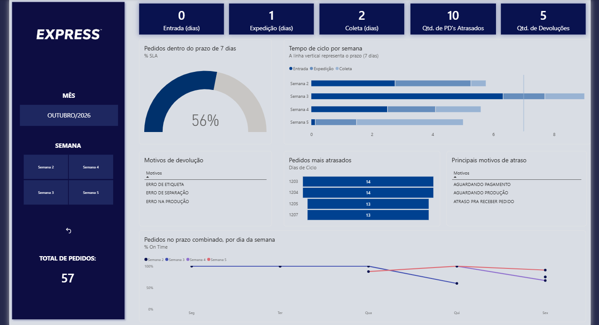
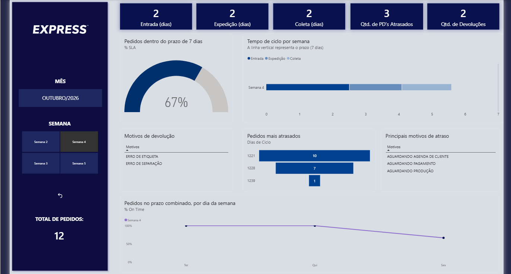
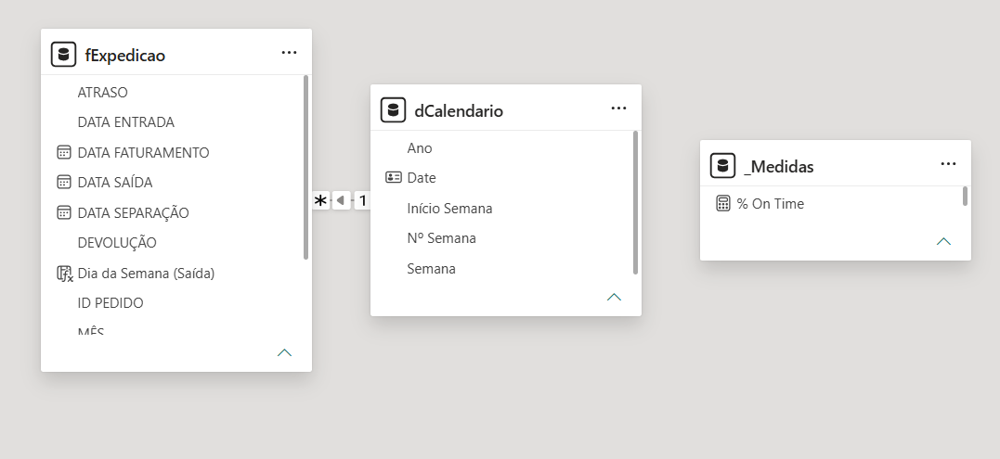

# Painel de Expedição / Shipping Dashboard
## Power BI

[Português](#português) | [English](#english)

---

## Português

### Sobre

Dashboard desenvolvido no **Power BI Desktop** para acompanhar os indicadores da área de expedição da **Express**, uma fábrica fictícia.

O painel ajuda a visualizar os processos da expedição:

- Quanto tempo cada etapa do processo leva (entrada, expedição e coleta)?
- Qual percentual dos pedidos sai dentro da meta de **7 dias**?
- Em quais dias da semana mais pedidos saem fora do prazo combinado com o cliente?
- Quantos pedidos foram devolvidos/atrasados e por quais motivos?

! ATENÇÃO: **Todos os dados deste repositório são fictícios.**

### Visualização

**Painel completo**


**Painel filtrado por mês e semana**


**Modelo de dados**


### Indicadores

| Visual | O que mostra |
|---|---|
| Cartões de tempo (entrada, expedição, coleta) | Tempo de cada etapa em dias inteiros: mediana na entrada, média nas demais |
| Total de pedidos | Total de pedidos do período filtrado |
| Quantidade de pedidos atrasados | Pedidos com motivo de atraso, ignorando os marcados como "SEM ATRASO" |
| Quantidade de devoluções | Pedidos devolvidos, ignorando os marcados como "SEM DEVOLUÇÃO" |
| Tabela de motivos de devolução | Os 3 motivos mais frequentes no período |
| Tabela de motivos de atraso | Os 3 motivos mais frequentes no período |
| Medidor de SLA | % de pedidos que saíram em até 7 dias desde a entrada |
| Linhas de On Time | % de pedidos no prazo combinado com o cliente, por dia da semana e por semana do mês |
| Barras empilhadas | Tempo médio de cada etapa por semana do mês, comparado à meta de 7 dias |
| Funil | Os 3 pedidos atrasados com maior tempo de ciclo |
| Segmentadores + botão de redefinir | Filtro por mês e semana, e limpeza dos filtros com um clique |

### Fonte de dados

Os dados vêm de uma planilha do **Google Planilhas**, com uma aba por mês (OUTUBRO, NOVEMBRO…). Estrutura de cada aba:

| Coluna | Conteúdo |
|---|---|
| ID PEDIDO | Identificador do pedido |
| ENTRADA NA EXPEDIÇÃO | Data em que o pedido chegou à expedição |
| SEPARAÇÃO | Data da separação |
| FATURAMENTO | Data do faturamento |
| COLETA / ENTREGA | Data em que o pedido saiu para o cliente |
| ATRASO | "SEM ATRASO" ou o motivo do atraso |
| DEVOLUÇÃO | "SEM DEVOLUÇÃO" ou o motivo da devolução |

A linha 1 de cada aba contém um título e a linha 2 contém os cabeçalhos. As datas seguem o formato dd/mm/aaaa.

### Tratamento dos dados (Power Query)

- **Junção automática das abas:** toda aba com nome de mês é incluída sozinha na atualização.
- **Limpeza:** remoção da linha de título, das linhas vazias e das colunas que não são usadas.
- **Datas no padrão brasileiro:** conversão com a cultura `pt-BR`. Valores inválidos viram vazio em vez de quebrar a atualização.
- **Mês de referência:** criado a partir do nome da aba, que é a regra de negócio da área.
- **Parâmetro `URL_Planilha`:** a fonte de dados pode ser trocada sem editar código.

### Modelagem

- **fExpedicao** (fato): um registro por pedido.
- **dCalendario** (dimensão): calendário com semanas começando na segunda-feira, relacionado à data de entrada.
- **_Medidas**: tabela dedicada às medidas DAX.

### Decisões de análise

- **Mediana no cartão de entrada:** os pedidos que dependem de produção ficam parados entre a entrada e a separação e levam bem mais tempo. A mediana mostra o tempo de um pedido típico nessa etapa. Nas etapas de expedição e coleta não há exceções desse tipo, então os cartões usam a média.
- **Média no gráfico de barras:** médias podem ser somadas, então o comprimento total de cada barra corresponde ao tempo médio do ciclo completo.
- **SLA × On Time:** o SLA mede o padrão interno de 7 dias. O On Time mede o prazo combinado com o cliente, registrado na coluna ATRASO. Um pedido sob produção pode estar fora do SLA e, mesmo assim, no prazo.
- **Pedidos em andamento:** pedidos sem as datas de uma etapa não entram no cálculo daquela etapa, e pedidos que ainda não saíram ficam fora do SLA e do On Time.

### Exemplos de medidas (DAX)

```DAX
Dias Entrada (mediana) =
MEDIANX (
    FILTER ( fExpedicao,
        NOT ISBLANK ( fExpedicao[DATA ENTRADA] ) && NOT ISBLANK ( fExpedicao[DATA SEPARAÇÃO] ) ),
    DATEDIFF ( fExpedicao[DATA ENTRADA], fExpedicao[DATA SEPARAÇÃO], DAY )
)
```

```DAX
% SLA = DIVIDE ( [Pedidos no SLA], [Pedidos Saídos] )
```

### Como usar

1. Instale o [Power BI Desktop](https://powerbi.microsoft.com/desktop/) (grátis - Windows).
2. Baixe e abra o arquivo `PAINEL_EXPEDICAO.pbix`.
3. Os dados fictícios já estão salvos. Para atualizá-los, clique em **Atualizar** e entre com uma conta Google.
4. Para usar outra planilha com a mesma estrutura: **Transformar dados → Editar parâmetros → URL_Planilha**.

### Tecnologias

Power BI Desktop, Power Query (M), DAX, Google Planilhas

### Autora

**Lorena Alves Santos** — estudante de Sistemas de Informação

### Licença

[LICENÇA]

---

## English

### About the project

Dashboard built in **Power BI Desktop** to track the shipping department indicators of **Express**, a fictional factory.

The dashboard helps visualize the shipping processes:

- How long does each stage of the process take (receiving, shipping and pickup)?
- What percentage of orders leaves within the **7-day** target?
- On which weekdays do more orders miss the deadline agreed with the customer?
- How many orders were returned/delayed, and why?

 ! BEWARE: **All data in this repository is fictional.**

### Preview

**Full dashboard**


**Dashboard filtered by month and week**


**Data model**


### Indicators

| Visual | What it shows |
|---|---|
| Time cards (receiving, shipping, pickup) | Time of each stage in whole days: median for receiving, average for the others |
| Total orders | Total orders in the filtered period |
| Delayed orders | Orders with a delay reason, excluding those marked "SEM ATRASO" (no delay) |
| Returns | Returned orders, excluding those marked "SEM DEVOLUÇÃO" (no return) |
| Return reasons table | The 3 most frequent reasons in the period |
| Delay reasons table | The 3 most frequent reasons in the period |
| SLA gauge | % of orders shipped within 7 days of receiving |
| On Time lines | % of orders on the deadline agreed with the customer, by weekday and by week of the month |
| Stacked bars | Average time of each stage by week of the month, compared to the 7-day target |
| Funnel | The 3 delayed orders with the longest cycle time |
| Slicers + reset button | Month and week filters, cleared with one click |

### Data source

Data comes from a **Google Sheets** spreadsheet with one tab per month (OUTUBRO, NOVEMBRO…). Columns in each tab (kept in Portuguese, as in the source):

| Column | Content |
|---|---|
| ID PEDIDO | Order ID |
| ENTRADA NA EXPEDIÇÃO | Date the order reached the shipping area |
| SEPARAÇÃO | Picking date |
| FATURAMENTO | Invoicing date |
| COLETA / ENTREGA | Date the order left for the customer |
| ATRASO | "SEM ATRASO" (no delay) or the delay reason |
| DEVOLUÇÃO | "SEM DEVOLUÇÃO" (no return) or the return reason |

Row 1 of each tab holds a title and row 2 holds the headers. Dates use the dd/mm/yyyy format.

### Data preparation (Power Query)

- **Automatic tab merge:** every tab named after a month is included automatically on refresh.
- **Cleaning:** removal of the title row, empty rows and unused columns.
- **Brazilian date format:** conversion using the `pt-BR` culture. Invalid values become blank instead of breaking the refresh.
- **Reference month:** derived from the tab name, which is the department's business rule.
- **`URL_Planilha` parameter:** the data source can be swapped without editing code.

### Data model

- **fExpedicao** (fact): one row per order.
- **dCalendario** (dimension): calendar with weeks starting on Monday, related to the receiving date.
- **_Medidas**: dedicated table for DAX measures.

### Analysis decisions

- **Median on the receiving card:** made-to-order items wait between receiving and picking and take much longer. The median shows a typical order at this stage. Shipping and pickup have no such exceptions, so their cards use the average.
- **Average on the bar chart:** averages can be added up, so the total length of each bar matches the average time of the full cycle.
- **SLA vs On Time:** SLA measures the internal 7-day standard. On Time measures the deadline agreed with the customer, recorded in the ATRASO column. A made-to-order item can be outside the SLA and still be on time.
- **Orders in progress:** orders missing the dates of a stage are left out of that stage's calculation, and orders not yet shipped are left out of SLA and On Time.

### Measure examples (DAX)

```DAX
Dias Entrada (mediana) =
MEDIANX (
    FILTER ( fExpedicao,
        NOT ISBLANK ( fExpedicao[DATA ENTRADA] ) && NOT ISBLANK ( fExpedicao[DATA SEPARAÇÃO] ) ),
    DATEDIFF ( fExpedicao[DATA ENTRADA], fExpedicao[DATA SEPARAÇÃO], DAY )
)
```

```DAX
% SLA = DIVIDE ( [Pedidos no SLA], [Pedidos Saídos] )
```

### How to use

1. Install [Power BI Desktop](https://powerbi.microsoft.com/desktop/) (free – Windows).
2. Download and open `PAINEL_EXPEDICAO.pbix`.
3. The fictional data is already saved. To refresh it, click **Refresh** and sign in with a Google account.
4. To use another spreadsheet with the same structure: **Transform data → Edit parameters → URL_Planilha**.

### Technologies

Power BI Desktop, Power Query (M), DAX, Google Sheets

### Author

**Lorena Alves Santos** — Information Systems student

### License

This project is licensed under the [MIT License](LICENSE).
